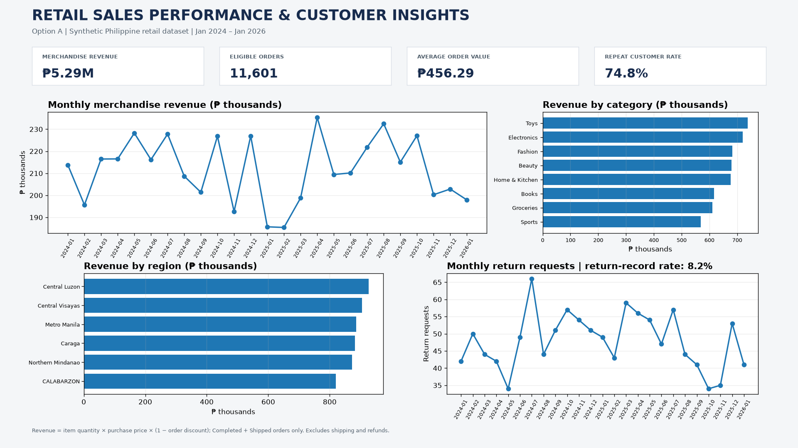

# Retail Sales Performance & Customer Insights

**Python Programming Data Analyst Capstone — Option A**

---

## 1. Project Overview

This project analyzes a synthetic Philippine retail/e-commerce dataset to understand store performance, customer purchasing behavior, product performance, regional sales, and return activity.

Using Python, Pandas, and Matplotlib, the project demonstrates a complete data analysis workflow, from data loading and cleaning to data integration, exploratory analysis, visualization, and business recommendations.

### Business Question

**How is the store performing, and what drives revenue?**

### Project Objectives

- Evaluate overall sales performance using key performance indicators.
- Identify top-performing products and categories.
- Examine customer purchasing and repeat purchase behavior.
- Compare revenue across regions and cities.
- Review monthly sales trends and return activity.
- Translate analytical findings into practical business recommendations.

### Dataset Description

The project uses seven related CSV datasets:

1. Customers
2. Orders
3. Products
4. Order Items
5. Payments
6. Returns
7. Shipments

The datasets represent synthetic Philippine retail/e-commerce training data.

---

## 2. Executive Summary

- This project examined sales performance and customer insights using a synthetic Philippine retail/e-commerce dataset.
- Seven related datasets were reviewed, cleaned, and prepared using Python and Pandas.
- The analysis produced an integrated sales fact table based on completed and shipped orders.
- Total merchandise revenue was **₱5,293,430.12** across **11,601 eligible orders**.
- Average order value was **₱456.29**.
- Repeat customers represented **74.8%** of purchasing customers.
- Toys recorded the highest category revenue at **₱738,320.75**.
- Central Luzon generated the highest regional revenue at approximately **₱926,983**.
- The findings highlight opportunities to review product profitability, support customer retention, monitor regional performance, and investigate returns.

A separate copy is available in [Executive Summary.txt](Executive%20Summary.txt).

---

## 3. Key Findings

| Metric | Result |
|---|---:|
| Merchandise Revenue | ₱5,293,430.12 |
| Eligible Orders | 11,601 |
| Average Order Value | ₱456.29 |
| Purchasing Customers | 4,519 |
| Repeat Customers | 3,378 |
| Repeat Customer Rate | 74.8% |
| Orders with Return Records | 957 |
| Return-Record Rate | 8.2% |

### Product Performance

Toys generated the highest category revenue at **₱738,320.75**, followed by Electronics at **₱719,343.29**.

### Regional Performance

Central Luzon recorded the highest regional revenue at approximately **₱926,983**, representing around **17.5%** of total merchandise revenue.

### Revenue Trend

Annual revenue decreased by approximately **1.8%** from 2024 to 2025. January 2026 represents a partial year and should not be directly compared with full-year totals.

### Customer Behavior

The repeat customer rate of **74.8%** indicates that repeat purchasing represents a substantial share of customer activity in the dataset.

### Returns

A total of 957 eligible orders had at least one associated return record. This is a return-record rate, not an item return rate or refund rate.

---

## 4. Dashboard and Visualizations

The project includes a consolidated dashboard created at **1920 × 1080 pixels**, along with five supporting charts.

### Main Dashboard

### Supporting Charts

1. [Monthly Revenue](charts/01_monthly_revenue.png)
2. [Top 10 Products](charts/02_top_10_products.png)
3. [Revenue by Region](charts/03_revenue_by_region.png)
4. [Customer Spend Distribution](charts/04_customer_spend_distribution.png)
5. [Monthly Returns](charts/05_monthly_returns.png)

---

## 5. Data Analysis and Methodology

### Data Cleaning and Preparation

Python and Pandas were used to:

- Remove duplicate records where applicable.
- Standardize product category names.
- Handle missing and invalid customer and product information.
- Convert relevant columns into appropriate numeric and date formats.
- Remove order items with zero or negative quantities.
- Validate customer, product, and order references.
- Backfill eligible missing purchase prices using corresponding product catalogue prices, while documenting the assumption.
- Record data preparation activities in a cleaning log.

### Data Integration

The cleaned datasets were combined to prepare an integrated sales fact table.

Sales analysis focused on completed and shipped orders. Payments, returns, and shipments were handled separately where appropriate to avoid duplicate counting.

### Key Metrics

- **Merchandise Revenue:** Revenue after discounts and before refunds, excluding shipping charges.
- **Eligible Orders:** Completed and shipped orders included in the sales analysis.
- **Average Order Value:** Merchandise revenue divided by eligible orders.
- **Repeat Customer Rate:** Percentage of purchasing customers with more than one eligible purchase.
- **Return-Record Rate:** Percentage of eligible orders with at least one associated return record.
- **Monthly Revenue:** Revenue grouped by month.
- **Product and Regional Revenue:** Revenue grouped by product, category, region, and city.

---

## 6. Business Insights

- Repeat purchasing is an important part of the observed customer activity.
- Toys and Electronics are the leading revenue-generating categories.
- Central Luzon is the strongest regional revenue contributor.
- The annual revenue decline warrants further monitoring by month, product category, and sales channel.
- Return activity should be examined to identify possible improvements in product information, order accuracy, quality checks, and delivery experience.

For a more detailed discussion, see the [One-Page Insights Summary](One-Page%20Insights%20Summary.md).

---

## 7. Recommendations

1. **Review Product Profitability:** Examine product costs and profit margins, especially for high-revenue categories, before making inventory or promotional decisions.
2. **Support Customer Retention:** Monitor repeat purchasing behavior and consider customer engagement or loyalty initiatives.
3. **Investigate Regional Performance:** Examine demand and fulfillment patterns in Central Luzon and other regions.
4. **Monitor Revenue Trends:** Track monthly performance and investigate the decrease between 2024 and 2025.
5. **Review Return Activity:** Examine return reasons and assess improvements to product descriptions, images, sizing or compatibility information, quality checks, and order fulfillment.

---

## 8. Project Files

### Python Notebook

- [YourNotebook.ipynb](YourNotebook.ipynb)

### Cleaned Datasets

- [Cleaned Customers CSV](data/cleaned_customers.csv)
- [Cleaned Products CSV](data/cleaned_products.csv)

### Executive Summary

- [Executive Summary.txt](Executive%20Summary.txt)

### One-Page Insights Summary

- [One-Page Insights Summary.md](One-Page%20Insights%20Summary.md)

### Charts

- [01 Monthly Revenue](charts/01_monthly_revenue.png)
- [02 Top 10 Products](charts/02_top_10_products.png)
- [03 Revenue by Region](charts/03_revenue_by_region.png)
- [04 Customer Spend Distribution](charts/04_customer_spend_distribution.png)
- [05 Monthly Returns](charts/05_monthly_returns.png)
- [Dashboard 1920 × 1080](charts/dashboard_1920x1080.png)

### Final Report

The completed capstone report in PDF format can be found in the `report` folder once uploaded.

---

## 9. Tools and Technologies

- **Python:** Main programming language for data analysis.
- **Pandas:** Data cleaning, preparation, integration, and analysis.
- **Matplotlib:** Data visualization and dashboard creation.
- **Jupyter Notebook:** Interactive development and documentation environment.
- **GitHub:** Project documentation, version control, and public submission.

---

## 10. Conclusion

This project demonstrates how Python can be used to clean, integrate, analyze, and visualize related retail datasets. The resulting KPIs, charts, and dashboard provide a structured view of sales performance and customer activity, highlighting opportunities for further business investigation and decision-making.

### Data Limitation

The datasets used in this project are synthetic training data. The findings are descriptive and apply only to the supplied dataset. They should not be interpreted as actual business performance or as proof of the causes behind observed trends.
